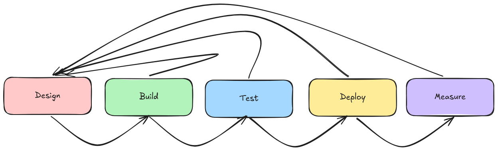

# DevOps

---

## Mitä kuuluu ohjelmistokehitysprosessiin?

<LiveTimeline storage-key="ohjelmistokehitysprosessi" initial="Koodin kirjoittaminen" class="mt-4" />

<!--
Kysy yleisöltä ideoita. Tuplaklikkaa tyhjää kohtaa (tai "+" oikeassa alakulmassa) lisätäksesi vaiheen,
raahaa laatikoita mihin tahansa, tuplaklikkaa laatikkoa muokataksesi, × poistaa, ↺ palauttaa alkutilaan.
-->

---

## Prosessin sidosryhmät

<LiveTimeline storage-key="prosessin-sidosryhmat" initial="Devitiimi" class="mt-4" />

<!--
Kysy yleisöltä ideoita. Tuplaklikkaa tyhjää kohtaa (tai "+" oikeassa alakulmassa) lisätäksesi sidosryhmän,
raahaa laatikoita mihin tahansa, tuplaklikkaa laatikkoa muokataksesi, × poistaa, ↺ palauttaa alkutilaan.
-->

---

## Muistutus: Agilen palautesilmukka

---

## Handoverit

<LiveTimeline storage-key="prosessin-sidosryhmat" initial="Devitiimi" class="mt-4" />

<!--
Sama tilanne kuin "Prosessin sidosryhmät" -dian: samat laatikot ja samat muutokset, koska molemmat käyttävät samaa tallennusavainta.
-->

---

## What is DevOps?

---

## Principles

---

## Practices

---

## Measuring DevOps
