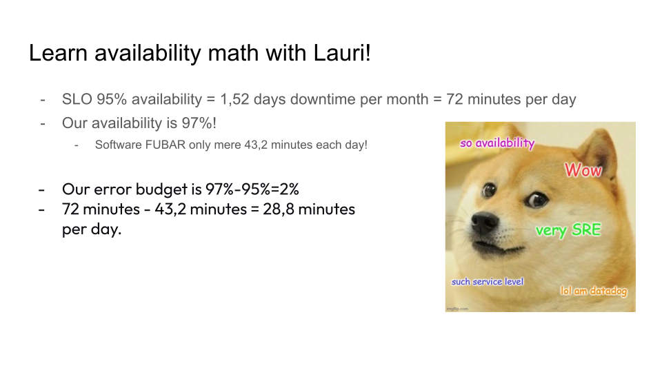
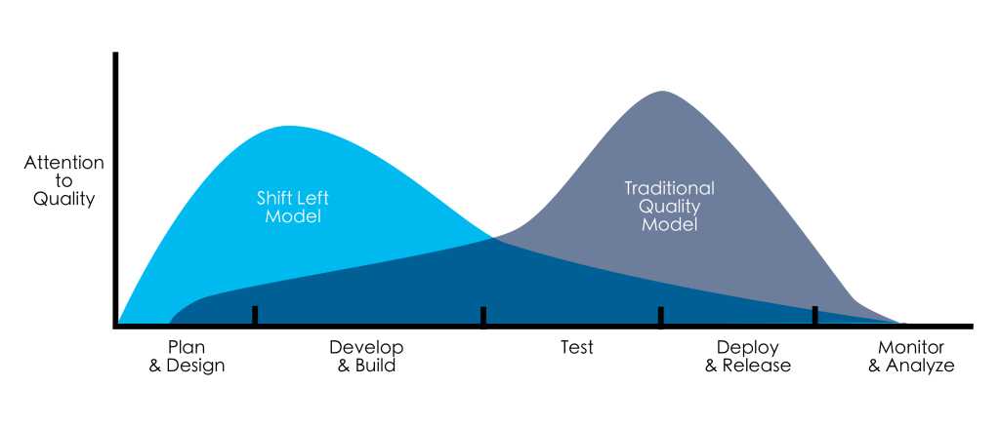
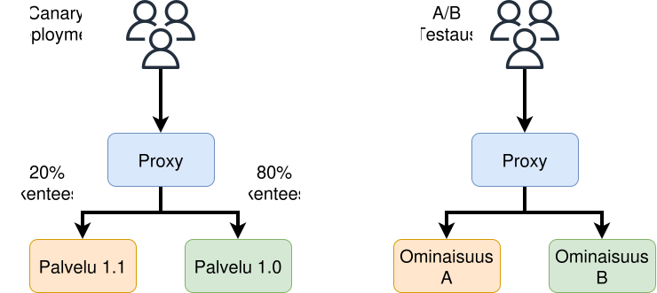
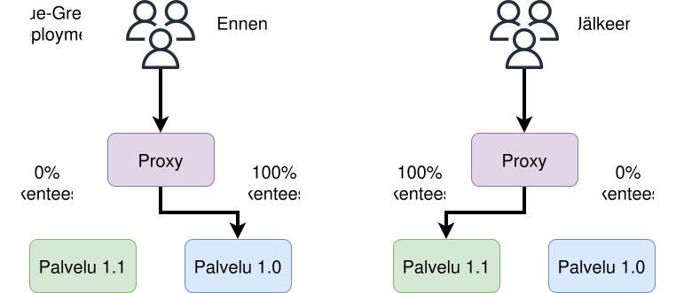

# DevOps

---

## Mitä kuuluu ohjelmistokehitysprosessiin?

<LiveTimeline storage-key="ohjelmistokehitysprosessi" initial="Koodin kirjoittaminen" class="mt-4" />

<!--
Kysy yleisöltä ideoita. Tuplaklikkaa tyhjää kohtaa (tai "+" oikeassa alakulmassa) lisätäksesi vaiheen,
raahaa laatikoita mihin tahansa, tuplaklikkaa laatikkoa muokataksesi, × poistaa, ↺ palauttaa alkutilaan.
-->

---

## Prosessin sidosryhmät

<LiveTimeline storage-key="prosessin-sidosryhmat" initial="Devitiimi" class="mt-4" />

<!--
Kysy yleisöltä ideoita. Tuplaklikkaa tyhjää kohtaa (tai "+" oikeassa alakulmassa) lisätäksesi sidosryhmän,
raahaa laatikoita mihin tahansa, tuplaklikkaa laatikkoa muokataksesi, × poistaa, ↺ palauttaa alkutilaan.
-->

---

## Muistutus: Agilen palautesilmukka

---

## Handoverit

<LiveTimeline storage-key="prosessin-sidosryhmat" initial="Devitiimi" class="mt-4" />

<!--
Sama tilanne kuin "Prosessin sidosryhmät" -dian: samat laatikot ja samat muutokset, koska molemmat käyttävät samaa tallennusavainta.
-->

---

## Mitä on DevOps?

- Andrew Schafer ja Patrick Debois käyttivät termiä ensimmäisen kerran 2008–2009
- DevOps on alunperin kulttuuri, filosofia ja joukko käytäntöjä, jotka yhdistävät ohjelmistokehityksen (Dev) ja
  IT-toimintojen (Ops) tiimit
- Mielestäni käsitettä voidaan laajentaa myös muuhun IT-organisaation osiin.

---

## Periaatteet

<v-clicks>

- Siilojen purkaminen
    - Yhteistyö ja yhteinen vastuu
- Työnkulun tehostaminen
    - Automaatio, CI/CD, Self-service
- Nopea palaute
    - Inkrementaalinen kehitys, jatkuva parantaminen, yhteiset mittarit
- Kokeilukulttuuri
    - Epäonnistumisen salliminen, nopea palautuminen, korkea luottamus
</v-clicks>

<h1 v-click class="text-center underline mt-12"> Gene Kim: The Three Ways </h1>

<!--
Nopea palautuminen toistoilla. 20% ajasta non-functional tekemiseen.
-->
---

## SRE

- Site Reliablility Engineering
- Google kehitti SRE:n 2003, kun heillä oli tarve hallita suuria järjestelmiä.
- Konsepteja:
    - SLA, SLO, SLI ja virhebudjetit
    - Toil reduction
    - Monitorinti ja mittaaminen
    - Blameless postmortem ja psykologinen turvallisuus

---

## Klassinen konsepti: DevOps Wall of Confusion

   
  

    
Devaaja haluaa julkaista mahdollisimman paljon ominaisuuksia.

    
Operaatioäijä haluaa pitää järjestelmän vakaana.

  

---

## You build it, you run it

   
  

    
- Alunperin Amazonilta 2026.  
- Vaatii monitaitoisen tiimin (Cross-functional).

    
Vaara:   - Skaalautuminen?   - Devitiimin aika kuluu muuhun, kuin devaamiseen.

  

---

## Virhebudjetit

   
  

    
- Devillä ja operaatioilla on yhteinen sopimus  
- Näin heillä on myös yhteinen tavoite, jonka onnistumista voidaan objektiivisesti seurata.

    
- Vaatii hyvin toteutetun metriikan 
- En ole kovin usein nähnyt oikeassa elämässä.

  

---
layout: image-left
image: ../images/slamath.png
backgroundSize: contain
---

## Virhebudjetit jatkuu 

 
 

 Esimerkkejä:

* HTML Status code 2xx / Xxx
* Tavoitevasteaika / Kaikki vasteajat
* Onnistuneet ostotapahtumat / Kaikki ostotapahtumat

<a href="https://vkolupaev.com/sre/img/availability-cheat-sheet.webp" target="_blank" class="text-blue-600 underline">Availability Cheat Sheet </a>

<!--
- slide 16, vois nostaa ehkä esimerkki luvuksi että AWS lupaa EC2 single-zone 99,95% ja multi-az arkkitehtuurille 99,99%, pätee kaikkiin muihinkin AWS compute palveluihin (harvalla multi-region oikeasti)
-->

---

---

## Mites ne muut seinät?

 - QA ja tietoturva

 - Shift-left 

Lähde: https://devopedia.org/shift-left/ 

 - Myös: DevSecOps 

---

## Miten sitten?

  
?

- Kulttuurinen muutos
  - Laatu sisällytetty jo suunnitteluvaiheeseen
- Esim. Test-driven Development (TDD)
- CI/CD putket
- Moniosaajatiimit (Cross-functional teams)
  - Avainhenkilöt mukana koko prosessin ajan
  - Two-pizza team?

---

## Shift-right?  
 

 - Khyl! 

 

 

---

## Blue/Green deployment
 

---
layout: image-right
image: ../images/Acceleratebook.jpg
backgroundSize: contain
---
## Prosessien mittaaminen

### DORA-mittarit (Accelerate, 2018)

- Lead time for changes
- Deployment frequency
- Mean time to restore (MTTR)
- Change failure rate

<v-clicks>

 - Parhaat tiimit suoriutuvat mittareilla hyvin ja eivätkä uhraa laatua tehokkuuden nimissä!
 - Huom! Korrelaatio vs kausaliteetti.
    - DORA-mittarit eivät mittaa esimerkiksi asiakastyytyväisyyttä, kehittäjäkokemusta yms.

</v-clicks>

---
layout: two-cols
---

## SPACE

::left::

- **S**atisfaction and well-being
- **P**erformance
- **A**ctivity
- **C**ommunication and collaboration
- **E**fficiency and flow

::right::

### DORA vs SPACE
| Aspect | DORA | SPACE |
|---|---|---|
| **Focus** | Software delivery performance | Developer productivity holistically |
| **Scope** | 4–5 specific metrics | 5 dimensions with many possible metrics |
| **Metrics** | Deployment frequency, lead time, change failure rate, time to restore | Varies by organization: satisfaction surveys, efficiency metrics, performance indicators, etc. |
| **Purpose** | Signal: "How are we doing?" | Diagnosis: "What should we improve?" |
| **Best for** | Benchmarking delivery capabilities | Understanding and improving developer experience |

Lähde: space-framework.com

<!--
S: Devaajien hyvinvointi. Työn imu, eNPS, psykologinen turvallisuus
P: Työn tulokset. Quality metrics, customer satisfaction
A: Työn tekeminen. Commitit, PR:t, buildit, deployt
C: Kommunikaatio, Dokumentaation laatu, onboarding, PR:n aukiolo.
E: Katkeamaton aika, Pipelinejen aika, WIP asioita kerrallaan.

-->

---
layout: image
image: ../images/devopsvenn.png
backgroundSize: contain
---