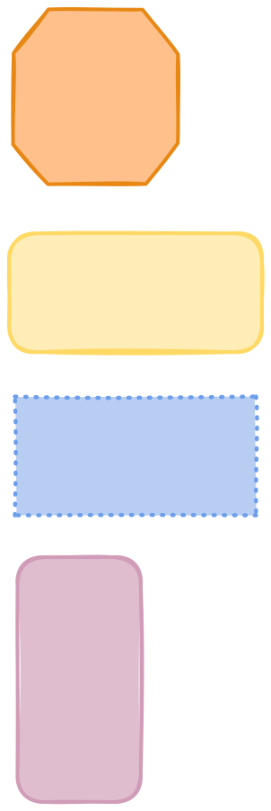
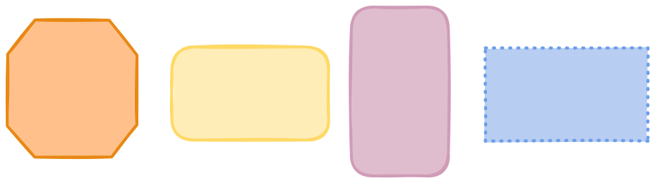

## Team Topologies

---
layout: image-right
image: ../images/TeamTopologies.jpg
backgroundSize: contain
---
## Team Topologies -kirja

- Matthew Skelton & Manuel Pais, 2019
- Käsittelee tiimeistä koostuvien IT-organisaatioden suunnittelua ja hallintaa
- Määrittelee neljä tiimityyppiä ja kolme vuorovaikutustapaa
- Käytännössä synnytti Platform Engineeringin

  OOH FORESHADOWING!!!

---
layout: center
class: text-center
---

## Conway's Law

<blockquote class="text-4xl italic max-w-4xl mx-auto leading-snug">
"Organizations which design systems (in the broad sense used here) are constrained to produce designs which are copies of the communication structures of these organizations."
</blockquote>

Melvin Conway, <i>How Do Committees Invent?</i>, Datamation, 1968

---

## Yhdeksän periaatetta  

1. Keskity työnkulkuun, älä organisaation rakenteeseen
2. Korkea luottamuksen taso on ehdoton
3. Pidä tiimit kasassa
4. Huomioi kognitiiviset rajat
5. Pidä muutokset pieninä ja turvallisina
6. Yhdistä tiimit suoraan asiakkaisiinsa
7. Hyväksy monimutkaisuus
8. Rakenna jatkuvan innovoinnin kulttuuri
9. Eliminoi tiimien väliset riippuvuudet

---
layout: default
---

  
  
Complicated Subsystem team

  
Stream-Aligned Team

  
Platform Team

  
Enabling Team

Neljä tiimityyppiä

---
layout: image
image: ../images/fourteamsinaction.svg
backgroundSize: contain
---
---
layout: image-left
image: ../images/interactionmodes.svg
backgroundSize: contain
---
## Interaktiomallit

|   | Collaboration | X-as-a-Service | Facilitating |
|---|---|---|---|
| Stream-Aligned | Typical | Typical | Occasional |
| Enabling | Occasional |   | Typical |
| Complicated Subsystem | Occasional | Typical |   |
| Platform | Occasional | Typical |   |

---

## Yhteenveto

- Organisaatiot tuottavat softaa, joka heijastaa organisaation rakenteita.
- Tiimit ovat organisaation perusyksikköjä, eivät vain kokoelma yksittäisiä ihmisiä.
- Ohjelmistot ovat hallittavia, jos tiimit ovat hallittavia.
- Tiimitopologiat ja interaktiomallit muuttuvat ajan saatossa.

