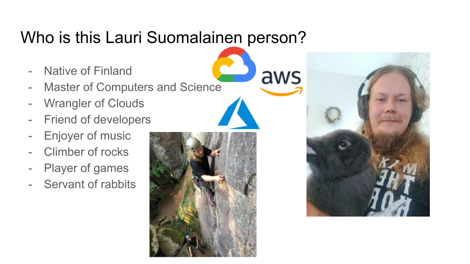

# Ohjelmistotuotanto kokonaisuutena
## Devops, Tiimitopologiat ja Platform Engineering

---
layout: center
---

---
class: text-sm
---

# CV

### Work

- **Part-time Lecturer**, University of Helsinki, 2012–2014
- **Research Assistant**, University of Helsinki, 2014–2017
- **Linux Specialist**, Nebula Oy, 2017
- **Software Designer**, Klinik Healthcare Solutions, 2018–2020
- **Cloud Architect**, Verifa, 2021–2025
- **Head of Cloud Development & Consultant**, Teamit, 2025–

### Education

- **BSc, Computer Science**, University of Helsinki, 2011–2014
- **MSc, Computer Science**, University of Helsinki, 2015–2019

### Volunteering

- **Chairman of the IT Committee**, Pääkaupunkiseudun Partiolaiset, 2016–2017
- **Product Owner** (Kompassi app), Suomen Partiolaiset, 2018–2023
- **NetCrew Member**, Assembly Organizing, 2019–2023
- **Co-founder & Organizer**, Helsinki HashiCorp User Group, 2021–2026
- **Co-organiser**, GDG Helsinki, 2025–2026
- **Mentoring**, Think Africa Ry, HY, 2025–
- **Co-founder & Organiser**, Platform & Infrastructure Community Finland, 2026–

---
src: ./pages/devops.md
---

---
src: ./pages/team-topologies.md
---

---
src: ./pages/platform-engineering.md
---

---
layout: image
image: ../images/neandertalinlauri.jpg
backgroundSize: cover
class: yhteenveto-text
---

## Yhteenvetona

<v-clicks depth="2">

- DevOps
    - Filosofinen ja kulttuurinen liike, jonka tavoitteena on purkaa IT-organisaation siiloja ja parantaa ohjelmistokehityksen laatua, nopeutta ja luotettavuutta automaatiolla ja palautesilmukoita tehostamalla sekä rakentamalla organisaatiokulttuuria joka rohkaisee kokeiluja eikä rankaise epäonnistumisista.
- Team Topologies
  - Tapa määritellä organisaation tiimejä ja kommunikaatiotapoja niin, että ne mahdollistavat sujuvan työnkulun. Tiimit ovat itsenäisiä entiteettejä, eivät vain kokoelma yksittäisiä ihmisiä.
- Platform Engineering
  - Tapa organisoida ohjelmistokehityksen tarvitsemia tukevia työkaluja ja infrastruktuuria niin, että kehitystiimit voivat keskittyä ydintehtäviinsä.

</v-clicks>

---
layout: two-cols-header
---

## Tekoälynkäyttöilmoitus
 

::left::

### Tekoälyä on käytetty

- Skriptien generointiin
- Osiin kuvista
- Asetteluun

::right::

### Tekoälyä ei ole käytetty

- Sisällön luomiseen
- Tutkimukseen ja tiedonhakuun

---